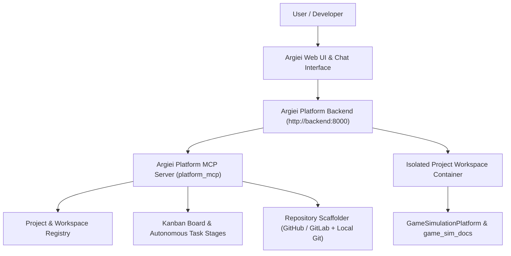
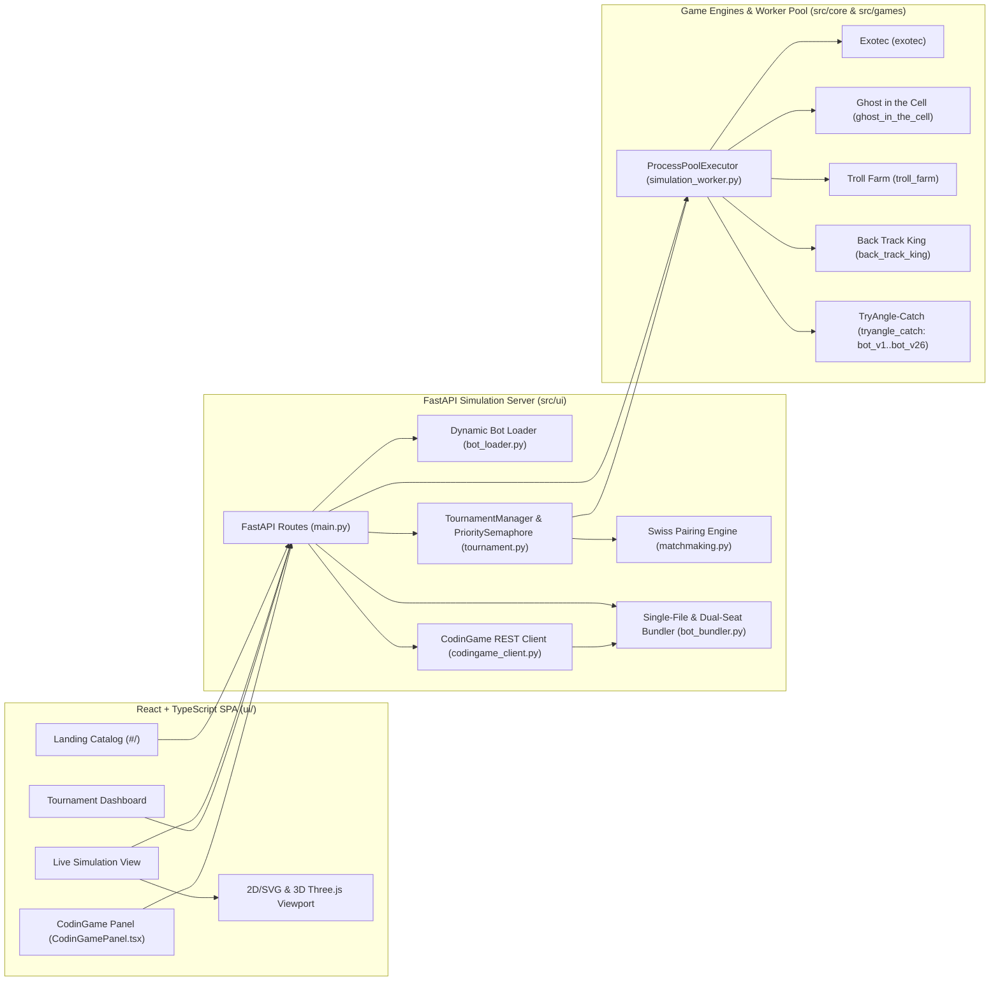

# Argiei & GameSimulationPlatform Architecture

This document provides a technical reference for the **Argiei Platform** (`argiei-platform`) and the **GameSimulationPlatform** (`lumenconsultancyae/GameSimulationPlatform`) hosted inside the `Codingame Competition` workspace.

---

## 1. Argiei Platform Overview

**Argiei** is an autonomous software engineering and multi-agent orchestration platform that manages projects, isolated container workspaces, Kanban task boards, multi-agent workflows, and GitHub/GitLab repository lifecycles.

### 1.1 Core Capabilities & MCP Tools (`argiei-platform`)

Agents interact with the Argiei Platform using the `platform_mcp` CLI (`platform_mcp list` and `platform_mcp call <tool_name> '<json_args>'`):

| Category | MCP Tool | Responsibility |
| :--- | :--- | :--- |
| **Projects & Workspaces** | `list_projects`, `get_project`, `create_project` | Inspect and provision projects, workspace directories (`projects/<slug>/default`), and deployment states. |
| **Repository Scaffolding** | `scaffold_project_repository` | Create and initialize local + remote GitHub/GitLab repositories (`blank`, `fastapi-react`, `python-service`, `node-service`), commit initial templates, push to remote, and register the repository in the project metadata. |
| **Conversations & Transcripts** | `list_conversations`, `create_conversation`, `get_conversation_transcript` | Create agent conversations and inspect cross-project conversation transcripts (`@conversation://<id>/transcript.jsonl`). |
| **Kanban Board & Workflows** | `list_board_tasks`, `create_board_task`, `update_board_task`, `delete_board_task`, `approve_board_task`, `list_workflows`, `list_agents` | Manage Kanban task lifecycles, acceptance criteria, and multi-agent stage transitions. |

---

## 2. GameSimulationPlatform Architecture

**GameSimulationPlatform** is a full-stack simulation, visualization, bot benchmarking, and tournament matchmaking platform for multi-agent programming competitions (such as CodinGame arenas).

### 2.1 Backend Subsystems (`src/ui/` & `src/core/`)

1. **FastAPI Control Plane (`src/ui/main.py`)**:
   - `GET /`: Lists registered games (`exotec`, `ghost_in_the_cell`, `troll_farm`, `back_track_king`, `tryangle_catch`) and league tiers (`Legend`, `Gold`, `Silver`, `Bronze`, `Wood`).
   - `GET /metadata?game_id=<id>`: Merges common leaderboard columns (`Rank`, `League`, `Bot Name`, `Dominance`, `Rating (Elo)`, `Perf`, `Win%`, `Loss%`, `Draw%`, `T1 Time`, `Avg Time`, `W-D-L`, `Total #`) with game-specific telemetry columns (e.g., `K% (F|K|S)` and `Bat%`).
   - `GET /bots?game_id=<id>`: Dynamically discovers bot classes under `src/games/<game_id>/bots/`, deduplicates backward-compatible class aliases by canonical `filename`, and formats versioned display labels (`v1`–`v26` for `tryangle_catch`, `v1`–`v52` for `back_track_king`).
   - `POST /run-simulation`: Runs a high-priority interactive match (or parses a `.e2e` replay log) and returns turn-by-turn state history for the visualizer.
   - `POST /batch-simulation`, `GET /tournament-stats`, `POST /stop-tournament`, `POST /reset-tournament`: Controls background Swiss tournament sessions and streams live Elo/Dominance standings.
   - `GET /bundle/{bot_filename}`: Bundles multi-file Python bot code and its transitive `src.*` imports into a single standalone submission script via `src/ui/bot_bundler.py` (`bundle_specific` and `bundle_match`), applying AST docstring/annotation stripping (preserving class-body `@dataclass` field annotations), Python 3.12+ f-string-safe token whitespace minification (`> 95,000` chars), and `zlib`+`base85` fallback (`> 99,000` chars) to stay strictly within CodinGame's `100,000`-character limit.

2. **Concurrency & Priority Scheduling (`src/ui/tournament.py` & `src/ui/simulation_worker.py`)**:
   - `PrioritySemaphore` ensures interactive `POST /run-simulation` requests (`priority=0`) preempt background batch tournament matches (`priority=1`) waiting for `ProcessPoolExecutor` slots.
   - `TournamentManager` tracks per-bot Win/Loss/Draw sub-reasons (`SCORE`, `KILL`/`DEATH`, `TIMEOUT`, `RESOURCE`, `STALEMATE`, `MUTUAL`), enforces a `100%` sub-percentage sum invariant via largest-remainder rounding (`distribute_sub_pcts`), and calculates Bayesian Elo ratings, Margins of Error (`MoE`), and Dominance scores.

3. **Swiss Matchmaking (`src/ui/matchmaking.py`)**:
   - `generate_swiss_pairings` groups participating bots by current tournament score, prioritizes bots with the fewest historical games, assigns odd-pool byes to the lowest-ranked unbyed bot, and applies a `-1000` rematch penalty (`REMATCH_PENALTY_SCORE`) to prevent repeat pairings within a session.

### 2.2 Frontend Visualizer (`ui/`)

- **Hash-Routed SPA (`ui/src/App.tsx`)**: Supports direct navigation to `#/` (Arena selection catalog) or `#/<game_id>` (Arena workspace with **Live View**, **Tournament**, and **CodinGame** tabs).
- **Interactive Viewport (`ui/src/components/Viewport.tsx` & `Scene3D.tsx`)**: Renders turn-by-turn board states, bot body segments, power sources, and trajectories with frame-accurate playback controls (`Play`/`Pause`, step forward/backward, speed multiplier, and timeline scrubber).
- **Tournament Analytics (`ui/src/App.tsx` & `ui/src/components/Leaderboard.tsx`)**: Displays real-time Elo/Dominance progression charts (Recharts), an Outcome Profile stacked bar chart, a Head-to-Head (`H2H`) win-rate matrix, and a sortable leaderboard table.
